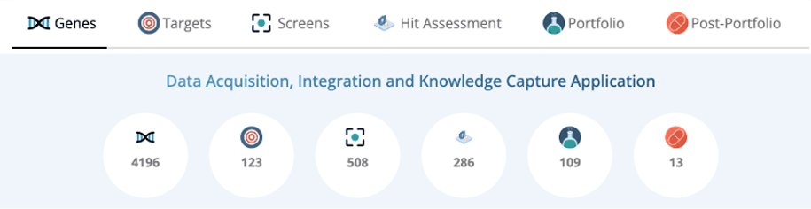

# Overview
DAIKON is an AI-enabled drug discovery platform designed to manage, integrate, and accelerate TB drug discovery across distributed research organizations. It supports the full lifecycle from **target ideation → screening → hit assessment → portfolio → post-portfolio**, combining experimental data, chemical intelligence, structural biology, and AI-driven knowledge extraction into a single system of record. 
Since its original conception as a target screening database, DAIKON has evolved into a AI research platform supporting 100K+ compounds, and multiple concurrent discovery programs for both target and phenotypic-based screening workflows.

> This repository documents and supports **DAIKON**, the official drug discovery platform developed and used by the TBDA consortium.  
> The public-facing overview of the platform is available at: https://saclab.github.io/daikon/. This user guide provides a high-level overview of the platform’s purpose and capabilities.

This repository focuses on:
- Product scope and decision rationale
- Platform capabilities and constraints
- Consortium-specific workflows and governance
- Configuration and implementation details

# Vision
DAIKON will function as an AI-augmented decision-support platform that assists scientists and researchers by surfacing insights, risks, and historical context while preserving human judgment and guide them to:

- Systematically evaluate and prioritize biological targets
- Rapidly assess chemical quality, liability, and novelty
- Integrate AI predictions directly into experimental decision-making
- Preserve institutional knowledge across years of discovery

# Scope
**What DAIKON does:**

DAIKON provides an integrated platform that:
-	Captures screening operations across labs and collaborators
-	Manages hits, chemical series, and progression decisions
-	Enforces compound disclosure workflows and ownership tracking
-	Provides core cheminformatics capabilities, including structure storage, property calculation, and visualization
-	Integrates AI-based nuisance detection to flag aggregators, reactive, luciferase inhibitors, and promiscuous molecules
-	Acts as a knowledge repository through doc summarization, tagging and search
-	Maintains project and portfolio lineage from target inception through horizon and timeline views
These capabilities are linked longitudinally across time, around:
-	targets
-	compounds
-	decisions
-	outcomes
This linkage preserves historical accuracy and enables continuity of scientific and portfolio context as discovery programs mature



**What DAIKON does NOT:**
DAIKON explicitly does not aim to:
-	Replace wet-lab execution systems (ELNs, LIMS, assay automation tools)
- Function as a standalone chemistry calculation engine or simulation platform
-	Serve as a generic document management or collaboration tool
-	Act as an autonomous AI discovery engine that replaces scientific judgment
-	Optimize laboratory throughput, scheduling, or experiment execution
-	Expand into late-stage clinical development or regulatory systems
DAIKON is designed to support decision-making, not to execute experiments, replace domain expertise, or automate discovery end-to-end.

# Target Users
This repository is intended for TBDA consortium members, collaborators, and reviewers evaluating the platform’s product design and implementation.

# Primary and Exclusive Users
TBDA Consortium Members, including:
- Medicinal chemists
- Structural biologists
- Target program leads and Principal investigators
- Screening and assay scientists
- Computational chemists
- AI and data science contributors
- Bioinformaticians
- Program and portfolio leads
These users operate across academic labs, pharmaceutical companies, biotech partners, and non-profit organizations within the TBDA consortium and collaborate on shared TB drug discovery programs.

# User Environment and Constraints
TBDA consortium members:
- Work with mixed proprietary and shared data
- Generate high-volume experimental, structural, and chemical datasets
- Operate across multiple institutions with different tooling standards
- Require traceability, auditability, and disclosure control
- Need AI systems that augment expert judgment, not replace it

DAIKON is designed to augment expert workflows, preserve institutional knowledge, and reduce friction across organizational boundaries.

# Core Product Capabilities
**1. Discovery Data Capture and Organization:**
DAIKON acts as the system of record for discovery data, enabling structured capture and retrieval of:
- Targets, genes, and biological context
- Phenotypic and target-based screens
- Hits, hit assessments, and compound series
- Assay metadata and experimental outcomes
All data is organized around biologically meaningful entities rather than isolated files, enabling longitudinal analysis and reuse.

**2. Dual-Mode Discovery Support**
- Target-based workflows: target prioritization, biochemical screens, structure-guided hit assessment
- Phenotypic workflows: whole-cell screens, phenotypic hit triage, resistance and validation data
The platform preserves traceability as programs transition between phenotypic discovery and validated targets, avoiding artificial silos.

**3. Project, Screen, and Pipeline Management:**
DAIKON provides structured pipeline views that reflect real discovery stages:
- Targets → Screens → Hit Assessment → Portfolio → Post-Portfolio
- Dedicated landing pages per stage
- Horizon and timeline views for longitudinal tracking
- Visual indicators for stalled or inactive screens
These views enable teams to monitor progress, identify bottlenecks, and maintain shared situational awareness across organizations.

**4. Collaboration and Activity Tracking:**
DAIKON includes built-in collaboration features:
- Activity feeds showing recent updates and changes
- Discussion threads linked to targets, screens, and projects
- Contextual visibility into who changed what and when
This ensures decisions and rationale remain visible and auditable across the consortium.

**5. Chemical Intelligence via MolecuLogix:**
DAIKON integrates MolecuLogix as its chemical intelligence layer, enabling:
- Storage and visualization of chemical structures
- Substructure and similarity searches
- Automated calculation of physicochemical properties
- Compound–target–project associations
- Reverse lookup from molecule to biological context
This provides medicinal chemists with direct chemical context inside discovery workflows.

**6. AI-Enabled Compound Quality Assessment:**
DAIKON integrates AI models directly into compound workflows to:
- Automatically flag nuisance compounds (aggregators, reactive compounds, luciferase inhibitors, promiscuous molecules)
- Surface risk signals early in hit assessment
- Support expert review rather than automate decisions
AI outputs are transparent and designed to augment scientific judgment.

**7. Knowledge Management and Retention:**
DAIKON functions as a long-term knowledge repository by:
- Extracting and summarizing information from large document collections
- Tagging and linking insights to targets, compounds, and projects
- Preserving historical rationale behind prioritization and progression decisions
This prevents loss of institutional memory across multi-year discovery programs.

**8. Secure, Consortium-Scale Deployment:**
DAIKON supports:
- On-premise or cloud deployment
- Enterprise authentication (e.g., Active Directory / SSO)
- Access control aligned with consortium governance
This enables secure collaboration across academic, pharma, biotech, and non-profit partners.

# Getting Started (Developers)
This repository contains the frontend codebase for the DAIKON platform. It is intended for contributors and collaborators working on development,
deployment, or evaluation of the system.

Detailed product context, scope, and user intent are described above.
The sections below focus on configuration and runtime setup.

## Deployment configuration
The auth and API settings are built into the app from two files in `src/config/` (gitignored).
Create them before `npm run dev`, `npm run build` or `docker build`:

`src/config/authConfig.jsx`
```
export const OIDCConfig = {
  authority: "https://login.microsoftonline.com/<tenant-id>/v2.0",
  client_id: "<spa-app-client-id>",
  redirect_uri: window.location.origin + "/auth/signin_redirect",
  response_type: "code",
  scope: "openid profile api://<api-app-id>/access_as_user",
  post_logout_redirect_uri: window.location.origin + "/auth/signout_redirect",
  response_mode: "query",
  automaticSilentRenew: true,
  silent_redirect_uri: window.location.origin + "/auth/silent_redirect",
};
```

`src/config/axiosConfig.js`
```
export const AxiosConfig = {
  baseURL: "https://<gateway-host>",
  headers: {
    "Content-Type": "application/json",
    Accept: "application/json",
  },
};
```

`baseURL` is the gateway as the browser reaches it; the gateway's CORS settings must allow the
app's origin. Alternatively set `baseURL: "/api"` and let the container (or `npm run dev`)
forward `/api` to the gateway, with `DAIKON_API_UPSTREAM` set to the gateway as
`http://host[:port]`, as the container reaches it (the name must resolve when the container
starts). `/api` is stripped before the request reaches the gateway.

```
docker build -t daikon2-fe .
docker run -p 3000:3000 daikon2-fe
```

In Entra ID, register the app as a Single-page application with these redirect URIs:
`<origin>/auth/signin_redirect`, `<origin>/auth/silent_redirect` and `<origin>/auth/signout_redirect`.

Set HSTS (`Strict-Transport-Security`) on your TLS terminator (ingress or load balancer);
the container doesn't set it because it can't tell whether TLS is in front of it.

### Keeping settings out of git
An image built from your checkout contains your `src/config` settings, so push it only to a
private registry. These values are not secrets (every user's browser sees them), but never put
secrets in them.

- `src/config/`, `public/config.js`, `.env.*`, `*.pem` and `*.key` are gitignored; CI fails if
  any of them is committed.
- `.env*`, `*.pem`, `*.key` and `public/config.js` are excluded from the Docker build context.
- gitleaks scans every push and pull request, and the whole history weekly. Trivy scans the
  built image for secrets.

### Local development
Create the two `src/config` files above. `npm run dev` serves the app on `http://localhost:3000`
and forwards `/api` to `http://localhost:8010` (set `DAIKON_API_UPSTREAM` to use another gateway).
